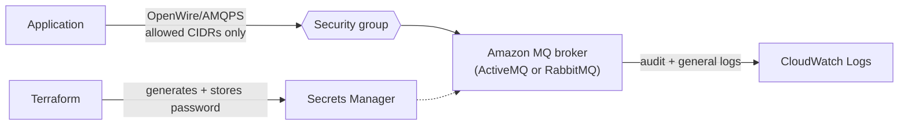

# terraform-aws-amazon-mq

Terraform that provisions an [Amazon MQ](https://aws.amazon.com/amazon-mq/) broker (ActiveMQ or RabbitMQ) inside an existing VPC, with a locked-down security group, encryption at rest, CloudWatch logging, and admin credentials generated into Secrets Manager by default so no password has to sit in a `.tfvars` file.

## Architecture



## What gets created

| Resource | Purpose |
|---|---|
| `aws_mq_broker` | The broker itself — ActiveMQ or RabbitMQ, single-instance or Multi-AZ |
| `aws_security_group` + rules | Ingress on the engine's protocol/console ports, only from `allowed_cidr_blocks` |
| `random_password` + `aws_secretsmanager_secret` | Auto-generated admin password stored in Secrets Manager (skipped if you supply your own) |
| `aws_cloudwatch_log_group` (audit/general) | Log groups the broker writes to when logging is enabled |

## Prerequisites

- Terraform 1.6 or newer
- An existing VPC and one or more private subnets (see [terraform-aws-vpc](https://github.com/metalaranna/terraform-aws-vpc) if you need one)
- AWS credentials with permission to create MQ, EC2 (security group), Secrets Manager, and CloudWatch Logs resources

## Quick start

```bash
git clone https://github.com/metalaranna/terraform-aws-amazon-mq.git
cd terraform-aws-amazon-mq

cp terraform.tfvars.example terraform.tfvars
# Edit vpc_id, subnet_ids, and allowed_cidr_blocks

terraform init
terraform plan
terraform apply
```

Retrieve the generated password if you didn't supply your own:

```bash
aws secretsmanager get-secret-value \
  --secret-id "$(terraform output -raw credentials_secret_arn)" \
  --query SecretString --output text | jq .
```

## Configuration

| Variable | Default | Description |
|---|---|---|
| `vpc_id` / `subnet_ids` | required | Where to place the broker. Use private subnets |
| `allowed_cidr_blocks` | required | CIDRs allowed to reach the broker. `0.0.0.0/0` is rejected by a validation rule |
| `engine_type` | `ActiveMQ` | `ActiveMQ` or `RabbitMQ` |
| `engine_version` | `5.18.6` | Check `aws mq describe-broker-engine-types` for currently supported versions |
| `host_instance_type` | `mq.t3.micro` | Broker instance size |
| `deployment_mode` | `SINGLE_INSTANCE` | `SINGLE_INSTANCE`, `ACTIVE_STANDBY_MULTI_AZ` (ActiveMQ HA), or `CLUSTER_MULTI_AZ` (RabbitMQ HA) |
| `publicly_accessible` | `false` | Whether the broker gets a public endpoint |
| `admin_username` | `admin` | Broker admin username |
| `admin_password` | `null` (auto-generated) | Supply your own, or leave unset to generate one into Secrets Manager |
| `audit_log_enabled` / `general_log_enabled` | `true` | CloudWatch logging toggles |
| `tags` | `{}` | Extra tags |

## Design notes / trade-offs

- **Multi-AZ needs two subnets in two AZs.** `ACTIVE_STANDBY_MULTI_AZ` (ActiveMQ) and `CLUSTER_MULTI_AZ` (RabbitMQ) both require `subnet_ids` to span at least two Availability Zones; `SINGLE_INSTANCE` only needs one subnet.
- **Password handling:** leaving `admin_password` unset is the safer default — Terraform generates a random password with `random_password` and writes it to Secrets Manager, so it never appears in your `.tfvars` file or in plain state diffs shown in CI logs. If you do pass your own password, mark the variable as sensitive at the call site too.
- **Ports differ by engine.** The security group opens 61617 (OpenWire) and 8162 (console) for ActiveMQ, or 5671 (AMQPS) and 443 (console) for RabbitMQ, based on `engine_type`.

## Cost

Amazon MQ bills per broker-instance-hour plus storage; Multi-AZ deployment modes run two instances. Check current [Amazon MQ pricing](https://aws.amazon.com/amazon-mq/pricing/) for your region.

## Cleanup

```bash
terraform destroy
```

## Development

```bash
terraform fmt -recursive
terraform init -backend=false
terraform validate
```

The same checks run in GitHub Actions on every push and pull request.

## License

MIT. See [LICENSE](LICENSE).
